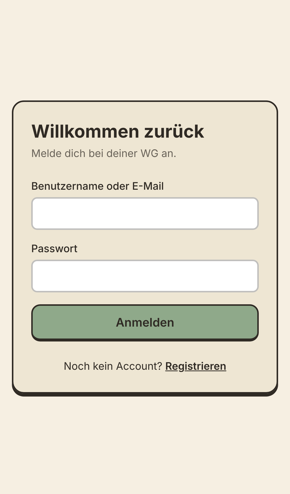
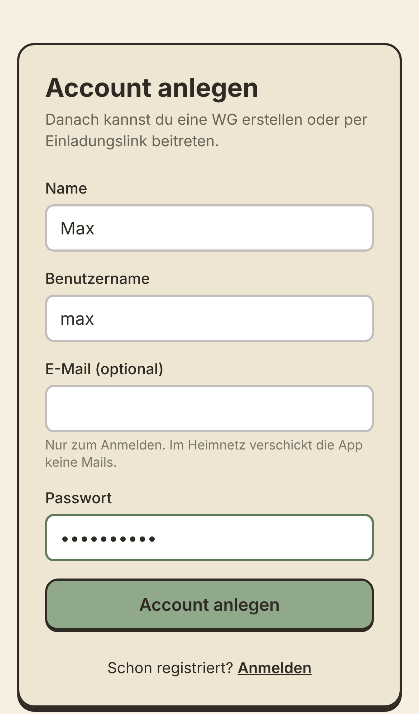
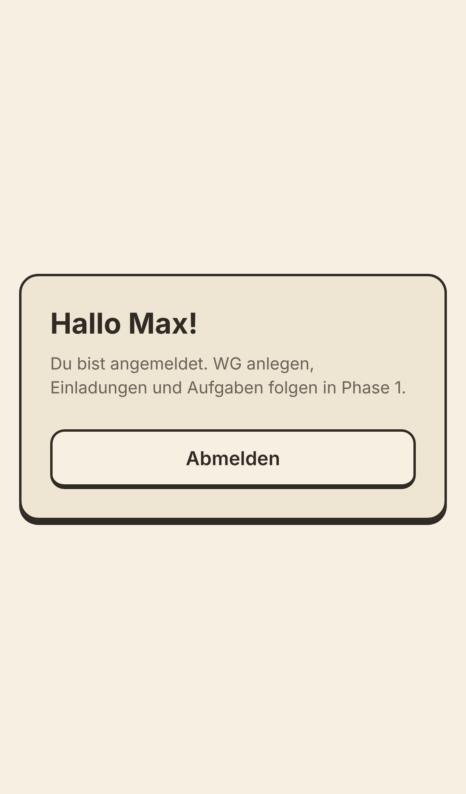

# 🏠 HRP – Household Ressource Planning

Die Haushalts-App für eure WG: Aufgaben mit rollierender Fälligkeit, Punkte für
Fairness und – bald – ein isometrischer Wohnungsplan, in dem sich Klo, Herd und
Mülleimer von grün nach rot verfärben. Selbst gehostet, läuft im Heimnetz.

## 🚀 Schnellstart

**Auf dem ZimaBoard (ZimaOS):**

1. ZimaOS öffnen → **App Store** → **Custom App installieren** →
   **Docker Compose importieren**.
2. Den Inhalt von [`docker-compose.yml`](docker-compose.yml) einfügen und
   installieren.
3. Am Handy `http://<zimaboard-ip>:3000` öffnen und den ersten Account anlegen.

**Mit Docker auf einem beliebigen Rechner:**

```bash
git clone https://github.com/maxseidlitz/HRP-Household-Ressource-Planning.git
cd HRP-Household-Ressource-Planning
docker compose up -d --build
# → http://localhost:3000
```

**Zum Entwickeln** (Node.js 22):

```bash
npm install
npm run dev
# → http://localhost:3000
```

Alle Daten liegen in einem Ordner (auf ZimaOS `/DATA/AppData/hrp`): SQLite-Datei,
Auth-Schlüssel und später Uploads und Backups. Diesen Ordner sichern, mehr
braucht es nicht.

## 📱 So sieht's aus

|                             Anmelden                              |                                   Registrieren                                   |                                      Startseite                                       |
| :---------------------------------------------------------------: | :------------------------------------------------------------------------------: | :-----------------------------------------------------------------------------------: |
|  |  |  |

> Stand: Phase 0. Die Screenshots werden mit jeder Phase automatisch neu erzeugt
> (`npm run screenshots`).

## ✨ Funktionen

|     | Funktion                                                                 | Status     |
| --- | ------------------------------------------------------------------------ | ---------- |
| 🔐  | Login mit Benutzername oder E-Mail, funktioniert ohne HTTPS im Heimnetz  | ✅ Phase 0 |
| 🐳  | Docker-Image, ZimaOS-Compose, automatische Migrationen                   | ✅ Phase 0 |
| 🏡  | WG anlegen, mehrere WGs pro Account, Einladung per Link + QR-Code        | Phase 1a   |
| 🧽  | Aufgaben mit Vorschlägen, rollierender Fälligkeit, Punkten und Rangliste | Phase 1a   |
| 🗺️  | Raum-Editor mit privaten Zimmern, Wohnungsplan mit Statusfarben          | Phase 1b   |
| 🎮  | Isometrisches Diorama mit Avataren und Schmutz-Effekten                  | Phase 2    |
| ⏰  | Einplanen, Kalender-Export (.ics), Mitteilungen, Urlaub                  | Phase 3    |
| 📊  | Admin-Statistiken, Feedback-Tickets, Widerspruch per Abstimmung          | Phase 4    |
| 🔔  | HTTPS, PWA-Installation, Push-Benachrichtigungen                         | Phase 5    |

Details: [Spezifikation](docs/SPEC.md) · [Umsetzungsplan](docs/PLAN.md)

## ⚙️ Konfiguration

Ohne Konfiguration lauffähig. Optional per Umgebungsvariable:

| Variable             | Standard | Bedeutung                                                                                                           |
| -------------------- | -------- | ------------------------------------------------------------------------------------------------------------------- |
| `DATA_DIR`           | `/data`  | Datenverzeichnis im Container                                                                                       |
| `ALLOWED_HOSTS`      | `*`      | Kommagetrennte Hosts (mit Port), unter denen die App erreichbar ist, z. B. `192.168.1.20:3000,zimaboard.local:3000` |
| `APP_PROTOCOL`       | `http`   | `https`, sobald die App hinter einem TLS-Proxy läuft                                                                |
| `BETTER_AUTH_URL`    | –        | Feste Basis-URL statt Ableitung aus dem Host                                                                        |
| `BETTER_AUTH_SECRET` | –        | Eigener Schlüssel; sonst wird beim ersten Start einer erzeugt                                                       |

### Fertiges Image statt selbst bauen

Bei jedem Push auf `main` baut die CI das Image
`ghcr.io/maxseidlitz/hrp-household-ressource-planning:latest`. Ist das Paket auf
GitHub privat, auf dem ZimaBoard einmalig `docker login ghcr.io` mit einem
Personal Access Token (Scope `read:packages`) ausführen oder das Paket in den
GitHub-Einstellungen öffentlich schalten.

## 🛠️ Entwicklung

| Befehl                | Zweck                                                      |
| --------------------- | ---------------------------------------------------------- |
| `npm run dev`         | Entwicklungsserver                                         |
| `npm run lint`        | ESLint                                                     |
| `npm run typecheck`   | Routen-Typen generieren + `tsc`                            |
| `npm test`            | Unit-Tests (Vitest)                                        |
| `npm run e2e`         | E2E-Tests (Playwright) gegen `E2E_BASE_URL`                |
| `npm run screenshots` | README-Screenshots neu erzeugen (frischer Build, leere DB) |
| `npm run format`      | Prettier                                                   |
| `npm run db:generate` | Neue Migration aus `src/db/schema.ts` erzeugen             |

**Technik:** Next.js 16 · TypeScript · SQLite + Drizzle · Better Auth ·
Tailwind CSS · Vitest · Playwright · Docker
